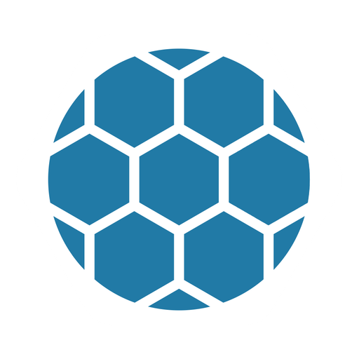

  

# GoBrrr Pool on StartOS

> **Upstream docs:** <https://github.com/gobrrrme/GoBrrr-Pool>
>
> Everything not listed in this document should behave the same as upstream
> GoBrrr Pool. If a feature, setting, or behavior is not mentioned here, the
> upstream documentation is accurate and fully applicable.

GoBrrr Pool is a self-hosted Bitcoin solo mining pool (ckpool-solo + web dashboard). Miners authenticate with their own Bitcoin address as the stratum username; a found block pays the full reward directly to that address.

---

## Table of Contents

- [Image and Container Runtime](#image-and-container-runtime)
- [Volume and Data Layout](#volume-and-data-layout)
- [Configuration Management](#configuration-management)
- [Network Access and Interfaces](#network-access-and-interfaces)
- [Actions (StartOS UI)](#actions-startos-ui)
- [Backups and Restore](#backups-and-restore)
- [Health Checks](#health-checks)
- [Dependencies](#dependencies)
- [Limitations and Differences](#limitations-and-differences)
- [What Is Unchanged from Upstream](#what-is-unchanged-from-upstream)

---

## Image and Container Runtime

Two prebuilt multi-arch (x86_64 / aarch64) images from the upstream project's registry, pinned by tag in the manifest:

- `ghcr.io/gobrrrme/gobrrr-ckpool` — the ckpool-solo daemon. Its entrypoint generates `/etc/ckpool/ckpool.conf` from environment variables supplied by `startos/main.ts`, then runs ckpool in BTC solo mode (`-B`). The exec command wraps the entrypoint to raise the open-file limit (stratum connections are file descriptors).
- `ghcr.io/gobrrrme/gobrrr-pool-webui` — the Node.js dashboard, run via its stock entrypoint.

A third daemon (`log-rotate`) reuses the webui image to run a shell loop that truncates ckpool's log (upstream ckpool never rotates it; it grows ~85 MB/day under load).

## Volume and Data Layout

| Volume | Mounted at | Contents | Backed up |
| --- | --- | --- | --- |
| `main` | `/app/data` (webui) | `miner-types.json` — long-term leaderboard cache | yes |
| `startos` | (file models) | `settings.json`, `store.json` (generated RPC password) | yes |
| `logs` | `/var/log/ckpool` (both daemons) | `ckpool.log`, per-worker `users/` files, `pool/` status | no |
| `sockets` | `/tmp/ckpool` (both daemons) | ckpool unix sockets (webui reads stats through them) | no |

## Configuration Management

All ckpool configuration is derived: the **Settings** action writes `settings.json`, and `startos/main.ts` maps it (plus the Bitcoin dependency's bridge address and generated RPC credentials) to the environment variables the ckpool entrypoint consumes. There is no user-editable ckpool.conf. Payout addresses are never configured — they arrive per-connection as stratum usernames (solo mode). The coinbase signature is fixed to `GoBrrrPool_start9` (not user-configurable, mirroring the Umbrel package's platform-tagged signature).

`MEMPOOL_API_URL` for the dashboard is wired automatically: the local Mempool service's address when installed, otherwise the public mempool.space API.

## Network Access and Interfaces

| Interface | Internal port | Protocol | Purpose |
| --- | --- | --- | --- |
| Web UI | 3000 | HTTP (TLS terminated by StartOS) | Dashboard |
| Stratum | 3333 | raw TCP | Miner connections (vardiff) |
| Stratum High-Diff | 4444 | raw TCP | Fixed high minimum difficulty for farms/rentals |

## Actions (StartOS UI)

- **Settings** — start/min/max difficulty, high-diff threshold, block poll interval, work update interval.

## Backups and Restore

`main` and `startos` volumes only. Logs and sockets are deliberately excluded — worker "bestever" stats live in log-volume `users/` files and are rebuilt from live data; the leaderboard cache (`miner-types.json`) is preserved.

## Health Checks

- **Stratum** — TCP listen check on 3333 (ckpool daemon)
- **Web Interface** — TCP listen check on 3000 (webui daemon, starts after ckpool)

## Dependencies

- **Bitcoin** (`bitcoind` — Bitcoin Core or Bitcoin Knots) — required, must be running and synced. Tasks configure it: pruning off (a pruned node's RPC is unreachable by dependents), ZMQ block notifications on, and a dedicated `rpcauth` user generated with a password stored in this package's `store.json`. ckpool uses RPC (`getblocktemplate`, `submitblock`, …) and ZMQ `hashblock` push notifications, falling back to 50 ms polling if ZMQ is unavailable.
- **Mempool** — optional. When installed, the dashboard's price/fee/block data is fetched from it over the bridge instead of from mempool.space (clearnet).

## Limitations and Differences

- The Umbrel package's home-screen stats widget (a separate ETL container) is not part of this package — StartOS has no equivalent widget surface.
- Found-block behavior cannot be integration-tested on mainnet; it relies on upstream ckpool-solo correctness.

## What Is Unchanged from Upstream

The ckpool daemon, its solo-mode semantics, the web dashboard, and both images are stock upstream builds — this package only supplies orchestration, configuration, dependency wiring, and log rotation.
